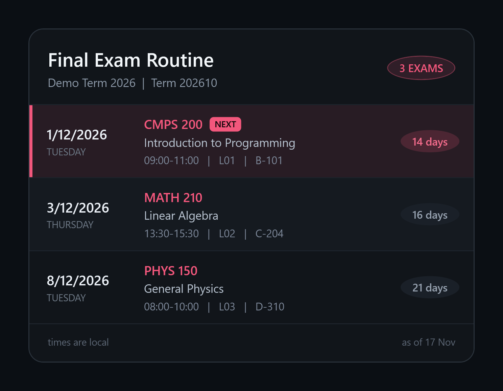
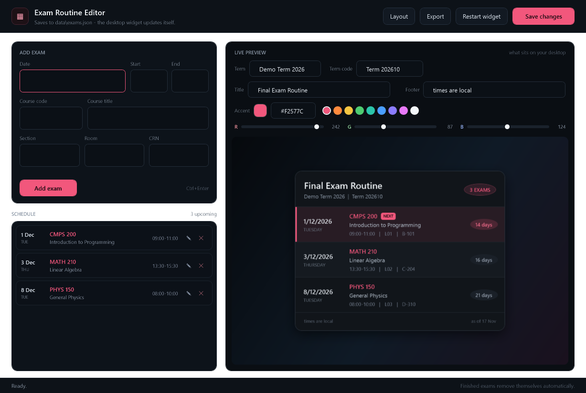

# Exam Routine Widget

A small exam countdown card that lives on your Windows desktop, with a GUI editor.

[](https://github.com/Hermesione/exam-routine-widget/actions/workflows/check.yml)



- Sits on the **desktop layer**: visible on the desktop (including after `Win + D`), hidden
  behind application windows, never steals clicks, never appears in Alt-Tab or the taskbar.
- Shows every exam with date, weekday, time, section, room, CRN and a live days-left badge.
- Highlights the **next** exam and turns the badge solid on exam day.
- **Finished exams remove themselves** once their end time passes.
- Custom **title, footer and accent colour** with automatic WCAG contrast protection.
- Edits apply to the desktop card within a couple of seconds - no restart needed.
- Drag and resize the card directly on the desktop, then lock it again with `Esc`.
- **PNG / PDF export** for printing or sharing, in light or dark style.
- Per-user install, **no admin rights**, no runtime to install.



## Requirements

- Windows 10 or Windows 11.
- Windows PowerShell 5.1, which is built into Windows.
- No .NET SDK, no Node, no admin rights.

## Install

### Installer (recommended)

1. Download `ExamRoutineWidget-<version>-Setup.exe` from
   [Releases](https://github.com/Hermesione/exam-routine-widget/releases).
2. Run it. It installs per user to `%LOCALAPPDATA%\Programs\ExamRoutineWidget`; no
   administrator prompt is needed.
3. Windows SmartScreen may warn because the installer is not code-signed. Choose
   **More info -> Run anyway**.
4. Optional checkboxes: desktop shortcut, start with Windows (both **off by default**).
   The editor opens at the end of setup.

### Portable ZIP

Download `ExamRoutineWidget-<version>.zip`, extract it anywhere, and run
`Edit Exam Routine.vbs`. The folder is self-contained: data, settings and backups are
created next to the scripts.

## Quick start

1. Double-click **`Edit Exam Routine.vbs`** (or the Start Menu shortcut).
2. Fill in date, start/end time, course code, title, section, room and CRN, then press
   **Add exam** (`Ctrl+Enter`).
3. Press **Save changes** (`Ctrl+S`). The card appears in the top-right corner of your
   main monitor.

The accent colour, card title and footer are on the right-hand side of the editor and
update the preview live.

## Layout

Right-click the tray icon for the card's menu.

- **Edit layout** unlocks the card: drag it with the mouse, drag the bottom-right corner
  to resize. Press `Esc` or choose **Edit layout** again to lock it. It also locks itself
  after 3 minutes of inactivity.
- **Size**: Compact (80%), Standard (100%), Large (120%).
- **Position**: nine anchors, remembered per monitor.
- **Reset layout**: back to top-right, 100%, top monitor.
- **Hide card / Show card**: keeps the widget running without showing the card.

The editor's **Layout** button offers the same controls plus a 70-150% slider and
**Adjust on desktop**, which minimises the editor and unlocks the card.

## Colour, title and footer

- Pick a preset, drag the R/G/B sliders, or type a hex value (`#RRGGBB`).
- If a colour would be unreadable, the card lightens or darkens just enough to keep at
  least 4.5:1 contrast for text and 3:1 for fills. The chosen hex is what gets saved.
- **Title** and **Footer** are plain text; clear them to fall back to
  `Final Exam Routine` and `times are local`.

## Export

Editor -> **Export**:

| Option | What you get |
|---|---|
| PNG / PDF | Rasterised card at 3x for crisp output |
| Print (light) / Desktop (dark) | White print style or the dark desktop style |
| A4 / Card size | PDF page size; disabled for PNG |

The export uses the current editor content, including unsaved edits. PNGs are
1488 px wide; PDFs embed a high-resolution image and need no external tools.

## Data and backups

Everything user-specific is in `data/` next to the scripts (or in the install folder):

| File | Purpose |
|---|---|
| `data/exams.json` | Term, accent, title, footer and the exam list |
| `data/settings.json` | Position, anchor, scale, monitor, lock state |
| `data/backups/` | Last 10 copies, written before every change |
| `data/edit-layout.request` | Transient hand-off from the editor to the widget |
| `widget.log` | Diagnostics, only when started with `-DebugLog` |

- Saving, auto-removing a finished exam and editor saves all create a backup first.
- If `exams.json` is unreadable, the app falls back to an empty schedule rather than
  crashing; restore a file from `data/backups/` and save.
- Older versions stored `exams.json` in the root; it is migrated into `data/` on first
  start.

## Start with Windows

Off by default. Enable it from the tray menu (**Start with Windows**) or the editor's
Layout dialog. It creates a per-user shortcut in
`%APPDATA%\Microsoft\Windows\Start Menu\Programs\Startup` - no admin, no Scheduled Task.

## Quit

Tray menu -> **Exit**. Closing the editor does not stop the widget; **Hide card** only
hides the card.

If a widget is already running, starting another instance exits immediately.

## Multi-monitor and DPI

The card remembers which monitor it is on and uses that monitor's work area (taskbar
aware). The app is system-DPI aware: mixed-DPI setups work, but every monitor is scaled
with the system DPI, so the card can look slightly larger or smaller on a monitor with a
different scale factor. True per-monitor DPI v2 is not implemented.

## Troubleshooting

| Problem | Fix |
|---|---|
| Card is not visible | It is behind your windows by design. Show the desktop (`Win + D`) or use tray -> **Show card**. |
| Card vanished after a restart | Tray -> **Reset layout**; the monitor layout may have changed. |
| Wrong monitor | Tray -> **Position**, or editor -> **Layout** and pick a spot on the target monitor. |
| SmartScreen blocks Setup.exe | **More info -> Run anyway**; the installer is unsigned. |
| Schedule looks wrong | Restore the newest file from `data/backups/`, or edit and save again. |
| Need diagnostics | Start the widget with `powershell -NoProfile -STA -ExecutionPolicy Bypass -File .\ExamWidget.ps1 -DebugLog`, reproduce, then read `widget.log`. |
| Autostart does not work | Delete the "Exam Routine Widget" shortcut in the Startup folder if it points to an old path, then re-enable it. |

## Uninstall

Settings -> Apps -> **Exam Routine Widget** -> Uninstall. The `data/` folder is kept so
you can reinstall without losing your schedule; delete the install folder manually to
remove it.

## Files

| File | Purpose |
|---|---|
| `Edit Exam Routine.vbs` | **Double-click this** to open the editor. |
| `Start Exam Widget.vbs` | Launches the widget without a console window. |
| `ExamEditor.ps1` | GUI editor with live preview, layout and export. |
| `ExamWidget.ps1` | The desktop widget and tray menu. |
| `lib/Card.ps1` | Shared theme, card renderer, JSON helpers, backups. |
| `lib/Layout.ps1` | Settings, screen math, anchors, autostart. |
| `lib/Export.ps1` | PNG and PDF writers (no external tools). |
| `assets/exam.ico` | App icon (tray, shortcuts, installer). |
| `version.txt` | Version shown in About and used by the build. |
| `docs/` | README screenshots. |

## Development

The scripts are plain PowerShell 5.1 + WPF; no build step is needed to run from source.

```powershell
# logic, JSON, layout, migration and contrast checks
powershell -NoProfile -STA -ExecutionPolicy Bypass -File .\tools\check.ps1

# render and validate PNG/PDF exports with demo data
powershell -NoProfile -STA -ExecutionPolicy Bypass -File .\tools\qa-export.ps1

# portable ZIP in dist/
powershell -NoProfile -STA -ExecutionPolicy Bypass -File .\tools\build.ps1

# regenerate the icon or the docs screenshots
powershell -NoProfile -STA -ExecutionPolicy Bypass -File .\tools\make-icon.ps1
powershell -NoProfile -STA -ExecutionPolicy Bypass -File .\tools\make-shots.ps1
```

The installer is an Inno Setup 6 script: `installer/ExamRoutineWidget.iss`, compiled by
CI on every `v*` tag. It installs per user, defaults to no autostart, and keeps `data/`
on uninstall.

Useful launch options:

```powershell
.\ExamWidget.ps1 -SnapPath .\preview.png          # render the card and exit
.\ExamWidget.ps1 -SnapPath .\preview-light.png -Theme light
.\ExamWidget.ps1 -DebugLog                        # write widget.log
.\ExamEditor.ps1 -SnapshotPath .\editor.png       # render the editor and exit
```

## License

**Source-available, not OSI open source.** This project is licensed under the
[PolyForm Noncommercial License 1.0.0](LICENSE), so you may use, modify and share it for
any noncommercial purpose, but not for commercial purposes. Commercial licensing:
contact the copyright holder through the repository.

Required Notice: Copyright (c) 2026 Hermesione (https://github.com/Hermesione)

Third-party names are used for compatibility only. Inno Setup is used at build time to
produce the installer; it is not bundled with the source.
